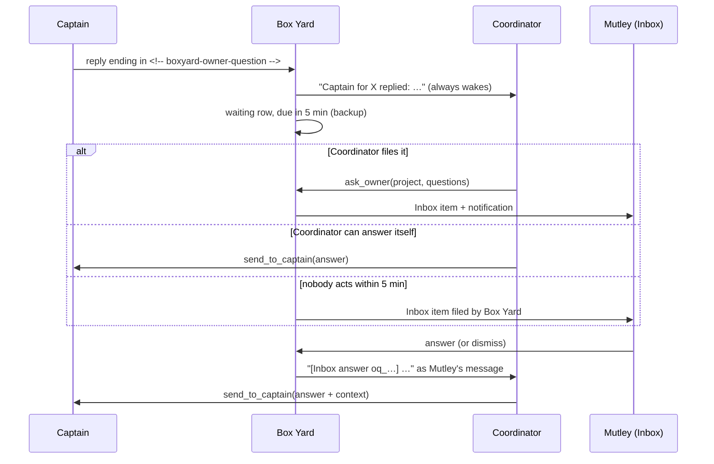

# Spec: Inbox for Coordinator questions (`ask_owner`)

Status: **Approved** (Mutley, 2026-11-15, all A picks). Nothing here is built yet.
File references (`file:line`) are to `main` at `4096ee6`.

## 1. The problem

When a Captain needs Mutley, its question ends up as plain text in a chat: the Coordinator's or the Captain's own.
Newer messages push it out of sight, so Mutley misses it. The Inbox ("Waiting on you" in the sidebar) shows only
tasks (`needs_input`, `pr_ready`, `failed`). A task agent's `ask_user` already gets a proper form with options and a
default; a Captain's question gets nothing.

## 2. The design in one picture



1. Captains talk to the Coordinator as now. New rule: a question for Mutley always goes up to the Coordinator, never
   only in the Captain's own chat.
2. Only the Coordinator gets the new tool, `ask_owner`. It files an Inbox item: the questions, their options and
   default, and the project whose Captain asked. Same several-questions shape as `ask_user`.
3. The item stays in the Inbox until Mutley answers or dismisses it. Phone first.
4. The answer goes to the Coordinator as a message (question, answer, project and Captain). The Coordinator passes it
   on with `send_to_captain`.
5. Backup: a Captain question with no Inbox item after 5 minutes is filed by Box Yard itself.
6. The Coordinator may group a Captain's related questions into one item, and may drop ones it can answer itself.

## 3. Where the code goes

New files hold almost everything, so upstream merges stay easy:

| New file | What it holds |
| --- | --- |
| `shared/ownerQuestions.ts` | The `OwnerQuestion` type, the Captain marker and its parser, the answer-message text, limits. Pure functions only. |
| `server/ownerQuestions.ts` | `OwnerQuestions` class: the table's reads and writes, filing, answering, dismissing, the backup sweep, notifications. |
| `server/ownerQuestionsTool.ts` | `registerAskOwner(server, helpers)`: the `ask_owner` MCP tool. |
| `server/ownerQuestionsRoutes.ts` | `ownerQuestionRoutes(api, ownerQuestions)`: the REST routes. |
| `web/src/lib/ownerQuestions.ts` | `useOwnerQuestions()`, `useAnswerOwnerQuestion()`, `useDismissOwnerQuestion()`, the `?ask=` URL helpers. |
| `web/src/components/OwnerQuestionRows.tsx` | The Inbox rows. |
| `web/src/components/OwnerQuestionSheet.tsx` | The answer sheet, mounted once (like `SettingsHost`). |

Hooks into existing files are one to five lines each. They are listed with each section below and collected in
section 13.

## 4. Data model and migration

One new table. A row is either a **waiting** Captain question (not shown, only there for the backup) or an **Inbox
item**.

Append to `MIGRATIONS` in `server/db.ts` (after the last entry, `server/db.ts:1326`; never edit a shipped one):

```sql
-- Questions for Cody from a project's Captain (docs/specs/inbox-owner-questions.md, server/ownerQuestions.ts).
-- state: waiting (a Captain asked, no Inbox item yet: the backup's clock runs, due_at), open (in the Inbox),
-- answered, dismissed, grouped (a waiting row an ask_owner item took over: grouped_into), handled (a waiting row
-- the Coordinator settled itself with send_to_captain or ask_captain).
-- filed_by: coordinator (ask_owner), backup (Box Yard, after due_at), captain (a status-only project's Captain,
-- filed straight away). NULL while waiting.
-- questions_json: AskQuestion[] (shared/askQuestions.ts); NULL for a plain question (backup or captain filing),
-- whose text is the Captain's own words.
CREATE TABLE owner_questions (
  id TEXT PRIMARY KEY,
  project_id TEXT NOT NULL REFERENCES projects(id) ON DELETE CASCADE,
  state TEXT NOT NULL,
  filed_by TEXT,
  intro TEXT,
  questions_json TEXT,
  text TEXT NOT NULL,
  captain_text TEXT,
  captain_message_id TEXT,
  grouped_into TEXT,
  answers_json TEXT,
  due_at INTEGER,
  created_at INTEGER NOT NULL,
  updated_at INTEGER NOT NULL,
  closed_at INTEGER
);
CREATE INDEX owner_questions_open ON owner_questions(state, project_id);
```

- `text` is always readable on its own: `questionsText(intro, questions)` (`shared/askQuestions.ts:82`) for a
  Coordinator item, the Captain's words for a plain one. Notifications, `list_inbox` and search read it.
- `captain_text`: the Captain reply that raised it, capped at 4,000 characters.
- Ids are `oq_` + 12 characters, through `newId("oq")` (`server/store.ts`).
- The class reads and writes `store.db` directly, as `HookStore` does (`server/hookStore.ts:1`, built at
  `server/app.ts:807`).

The shared type (`shared/ownerQuestions.ts`), which the web gets for open items only:

```ts
export interface OwnerQuestion {
  id: string
  projectId: string
  state: "open" | "answered" | "dismissed"
  filedBy: "coordinator" | "backup" | "captain"
  intro: string | null
  /** Null: a plain question; the form shows one answer box. */
  questions: AskQuestion[] | null
  text: string
  createdAt: number
  closedAt: number | null
}
```

Limits: at most 10 open items per project (the Coordinator should group), and at most one waiting row per project (a
second marked reply while one waits adds its text to that row and keeps its `due_at`, so a looping Captain can't
flood the Inbox).

## 5. How a Captain question is detected

A Captain marks a reply that holds a question for Mutley with a hidden line, the same way it already marks FYI replies
(`FYI_MARKER`, `server/captainWake.ts:9`):

```
<!-- boxyard-owner-question -->
```

`shared/ownerQuestions.ts` exports `OWNER_QUESTION_MARKER` and `takeOwnerQuestionMarker(text)` →
`{ text, asked }`, a copy of `takeFyiMarker`'s shape (`server/captainWake.ts:13`).

Hooks in `server/captains.ts`:

1. Parse (`:1851`, right after `takeFyiMarker`): strip the marker from the text the chat shows and set a local
   `ownerQuestion = true`, as `fyi` is set at `:1858`. Carry it out with the reply: add `ownerQuestion?: boolean`
   to `onResult` (`:83`), `RunResult` (`:96`), `TurnReply` (`:103`), and pass it where `fyi` is passed (`:1898`,
   `:1944`).
2. It always wakes the Coordinator: in `replyUpward` (`:1320`) and `reportAuto` (`:1343`) pass
   `fyi: … && !result.ownerQuestion`, and add `ownerQuestion: true` to the `CaptainReport` (type at `:212`).
3. It reaches the Coordinator even when Mutley was chatting with the Captain directly. In `runPrompt`'s `relay`
   (`:1464`), after the existing two lines:
   `if (reply.ownerQuestion && !auto && ask.replySource !== "coordinator") this.onOwnerQuestion?.(reply.text)`.
   The manager's `onOwnerQuestion` reports it upward like an automatic report, with `{ ownerQuestion: true }`.
   A turn answering the Coordinator already went up through `replyUpward`.
4. While the reply streams, `shared/captainStream.ts:12` and `:54` hide the new marker as they hide the FYI one (one
   regex alternation).

Then `captains.onReport` in `server/app.ts:843` gets one line: when `report.ownerQuestion`, call
`ownerQuestions.captainAsked(projectId, content, msg.id)`. That writes (or extends) the waiting row with
`due_at = now + 5 min`.

**Status-only projects** (`docs/identities.md`): the Coordinator must not see their content. There,
`captainAsked` files an open item at once (`filed_by = captain`, a plain question) and the reply is not reported
upward (the `onOwnerQuestion` hook skips it when `identities.statusOnly(projectId)`). Mutley's answer goes straight to
the Captain. See decision 4.

## 6. The tool: `ask_owner`

Coordinator only. Registered in `server/ownerQuestionsTool.ts`; `server/mcp.ts` gets one call after `list_inbox`
(`server/mcp.ts:1917`):

```ts
coordinatorOnly(registerAskOwner(server, { project, unsealed, owner, ownerQuestions: deps.ownerQuestions }))
```

`coordinatorOnly` (`server/mcp.ts:449`) removes it for Captains, so a Captain can't reach another project. It is
**not** added to the side threads' read-only `THREAD_TOOLS` (`server/sideThreads.ts:78`): it writes. It is added to
the Coordinator's `CORE_TOOLS` (`server/mcp.ts:244`) so it's always loaded (decision 7). `McpDeps`
(`server/mcp.ts:71`) gets `ownerQuestions?: OwnerQuestions`, passed at `server/app.ts:958`.

**Description** (goes through `withOwner`, like every tool description, via `nameOwnerInTools`):

> Coordinator tool: put a Captain's question for Cody in Cody's Inbox, as a form with your recommended answer and the
> other options for each question. Use it for every question or decision only Cody can make that a Captain sent you,
> instead of asking in your reply, where newer messages hide it. One call per project: group that Captain's related
> questions (up to 10). Don't file what you can answer yourself: send_to_captain the answer instead. Cody's answer
> comes back to you as a message starting "[Inbox answer oq_…]"; pass it on with send_to_captain.

**Schema** (the same names as `ask_user`'s, so the Coordinator writes it the way agents do):

```ts
{
  project: z.string().describe("Project id or name: whose Captain asked"),
  question: z.string().max(MAX_QUESTION_TEXT).optional()
    .describe("One or two lines of context shown above the questions"),
  questions: z.array(z.object({
    question: z.string().describe("The question, in Markdown"),
    default_answer: z.string().describe("Your recommended answer, pre-selected"),
    options: z.array(z.string()).max(MAX_OPTIONS).optional()
      .describe("The other answers worth offering. Cody can always type their own."),
  })).min(1).max(MAX_QUESTIONS),
}
```

**Validation**, in order, each a tool error the Coordinator can fix:

1. `project(a.project)`: an unknown project fails (`server/mcp.ts:356`).
2. `questionsProblem(a.questions)` (`shared/askQuestions.ts:60`): every question needs text and a default, options
   are capped.
3. `normalizeQuestions(a.questions)` (`shared/askQuestions.ts:35`): trims, drops blanks and repeats, caps lengths.
4. More than 10 open items for the project: "Cody already has 10 open questions for this project. Group them, or
   wait for answers."

**Idempotent**: an open item for the same project with the same `askKey` (`shared/askQuestions.ts:112`) is returned
as is, with `duplicate: true`. A retried turn doesn't file twice.

**Effects**: inserts the open item; marks the project's waiting rows `grouped` with `grouped_into` = the new id
(their backup is off); sends the notification (section 10); broadcasts the item (section 7).

**Return value**:

```json
{
  "filed": "oq_7k2m9x1p4q5r",
  "project": "box-yard",
  "questions": 2,
  "groupedCaptainQuestions": 1,
  "duplicate": false,
  "next": "It's in Cody's Inbox. Tell Cody in one line; don't ask the same thing in your reply. The answer comes to you as a message starting [Inbox answer oq_7k2m9x1p4q5r]."
}
```

**Dropping questions it can answer.** `send_to_captain` (`server/mcp.ts:849`) and `ask_captain` (`:869`) each get one
line: `deps.ownerQuestions?.coordinatorReplied(projectId)`, which marks that project's waiting rows `handled`. So a
question the Coordinator settled itself never reaches the backup.

`list_inbox` (`server/mcp.ts:1912`) adds the open items as `ownerQuestions: [{ id, project, text, filedBy, createdAt }]`
(two lines), so the Coordinator can see what's already asked before it files again. Content of a status-only project's
items is left out (`statusOnly()`).

## 7. The API

Mounted with one line next to `transcriptHistoryRoutes(api, store)` (`server/app.ts:1027`), which is the existing
precedent for a route module:

```ts
ownerQuestionRoutes(api, ownerQuestions)
```

So every route sits behind `auth.middleware()` (`server/app.ts:1026`) and the browser Host/Origin checks
(`browserBoundary`). Only the signed-in owner can answer or dismiss. No MCP tool answers or dismisses an item, so no
agent can.

| Route | Body | Answer |
| --- | --- | --- |
| `GET /api/owner-questions` | | `OwnerQuestion[]`, open only, newest first |
| `POST /api/owner-questions/:id/answers` | `{ id: string, key: string, answers: string[] }` | the closed `OwnerQuestion` |
| `POST /api/owner-questions/:id/dismiss` | `{}` | the closed `OwnerQuestion` |

- `answers` checks, like `/tasks/:id/answers` (`server/app.ts:1486`, `TaskManager.answerQuestions` at
  `server/tasks.ts:1378`): `key` must equal the item's `askKey` (409 "These questions changed"), `answersProblem`
  (`shared/askQuestions.ts:130`, 400). A plain item takes one answer and `key: "plain"`. Each answer is at most
  `MAX_ANSWER_TEXT`.
- A closed item answers 409 "Already answered" or "Already dismissed". An unknown id: 404.
- `id` is the client's message id, so a double tap sends once (same as the task answers route).
- Live updates: a new event in `ServerEvent` (`shared/types.ts:696`):
  `{ type: "owner.question"; question: OwnerQuestion }`, broadcast on file, answer and dismiss. The web's stream
  (`web/src/lib/stream.ts:360`) gets one `case` that upserts or removes it in the query cache.

**What the answer does.** `OwnerQuestions.answer()` closes the item, then sends the message:

- A Coordinator item: to the Coordinator as Mutley's message, through `orchestrator.hookMessage(text, meta)`
  (`server/orchestrator.ts:321`, which queues it mid-turn and starts a turn otherwise), with
  `meta = { ownerQuestion: id }`.
- A backup or status-only item: straight to the Captain, `captains.send(projectId, text, { source: "cody" })` (FOR
  MUTLEY 3 and 4). For a backup item the Coordinator also gets a quiet chat notice (no wake):
  `📥 **Inbox** answered: Cody answered the Captain for <project>'s question; it went to the Captain.`

The message text comes from `answerMessage(item, answers, projectName)` in `shared/ownerQuestions.ts`. It reuses
`formatAnswers` (`shared/askQuestions.ts:145`):

```
[Inbox answer oq_7k2m9x1p4q5r · Captain for "box-yard" (prj_1a2b3c4d5e6f)]
Cody answered the question you filed for the Captain for "box-yard". Pass it on with send_to_captain, with any context it needs.

My answers to your 2 questions:

1. Which database should the spike use?
   - Postgres (your default)
2. Keep the old API for a release?
   - No, drop it now; nobody calls it (my own answer)
```

A plain item ends with `My answer:` and the typed text instead.

**Dismiss** closes the item and tells both sides quietly, without a turn (decision 5):

- the Coordinator chat: a `fyi` notice, like `captains.onReport` does (`server/app.ts:847`):
  `📥 **Inbox** dismissed: Cody dismissed the Captain for <project>'s question: <first line>`;
- the Captain: `captains.projectNotice(projectId, …, {}, { wake: false })` (`server/captains.ts:503`), so it reads it
  with its next turn.

The notice text goes through `withOwner`, and the 📥 emoji is added to `EMOJI_KIND` in
`web/src/lib/captainTranscript.ts` with a case in `test/captain-transcript.test.ts` (AGENTS.md, Notices).

## 8. Prompt changes

### Coordinator

In `ORCHESTRATOR_PROMPT` (`server/prompts.ts:439`), a new paragraph right before "Other tools:"
(`server/prompts.ts:505`):

> Questions for Cody from Captains: when a Captain's reply holds a question or decision only Cody can make, put it in
> Cody's Inbox with ask_owner, never only as text in your reply, where newer messages hide it. One ask_owner call per
> project: group that Captain's related questions into it (up to 10), each with your recommended default_answer and
> the other options. When you can answer it yourself (Cody already said, the project's notes, the yard's state),
> send_to_captain the answer instead and don't file it. Then say in one line of your reply that it's in the Inbox.
> Cody's answer comes back to you as a message starting "[Inbox answer oq_…]" with the question, the answer and the
> Captain it's for: pass it to that Captain with send_to_captain in the same turn, adding any context it needs.

The existing line "relay agents' questions to Cody plainly" (`:505`) stays: task agents keep their own `ask_user`
form.

### Captains

In `captainPrompt` (`server/prompts.ts:538`), a new line right after the FYI line (`server/prompts.ts:551`), through
`own()` so the name is Mutley's:

> Questions for Cody: any question or decision only Cody can make goes up to the Coordinator, never only in your own
> chat, even when Cody is talking to you here (they may have left). Ask it in your reply as a short, self-contained
> question with your recommended answer and the other options, and end the reply with this hidden line on its own:
> `<!-- boxyard-owner-question -->`. Box Yard then sends the reply to the Coordinator, which puts it in Cody's Inbox
> and passes the answer back to you. Never mark such a reply FYI. Questions you can settle yourself don't need the
> line.

The marker is interpolated from `OWNER_QUESTION_MARKER`, as `FYI_MARKER` is.

For a status-only project, the existing status-only line (`server/prompts.ts:571`) gets one more sentence:

> In this project a reply with the owner-question line goes straight to Cody's Inbox, not to the Coordinator, and
> Cody's answer comes straight back to you.

## 9. Web UI (phone first)

### In the Inbox

The Inbox is the sidebar's "Waiting on you" group (`WaitingOnYou`, `web/src/components/Sidebar.tsx:1414`), which on a
phone is in the sidebar drawer behind the menu button and its badge (`SidebarMenuButton`, `Sidebar.tsx:213`).

- Question rows go **first** in the group, above the task rows, newest first: they are asks, and asks already lead
  (`ORDER`, `web/src/lib/sidebar.ts:53`).
- A row: the amber question icon (`MessageCircleQuestion`, as on the task ask card), "Captain for <project>" with the
  project's colour square, then the first question on one line and the time (`TimeAgo`). 44 px tall on a touch screen
  (`pointer-coarse:min-h-11`), with `treeItem(…)` so arrow keys move through it like the task rows.
- The count and the amber "asks" badge include open questions: `useInboxCount` (`Sidebar.tsx:186`) adds
  `questions.length` and sets `asks` when there are any. The tab title count (`NotificationEffects.tsx:27`) adds
  them too.
- The cap of 5 rows (`WAITING_CAP`, `sidebar.ts:244`) counts question rows too; "Show all n" shows the rest.

Hooks in `Sidebar.tsx`: `useInboxCount` (two lines), and `WaitingOnYou` takes `questions` and renders
`<OwnerQuestionRows>` before its task rows, with `total` including them (about five lines). Rows live in
`OwnerQuestionRows.tsx`, memo'd, and keep their order with `useStableOrder` so an answered row dims out instead of
jumping.

### The answer sheet

Tapping a row (or a notification) opens `OwnerQuestionSheet`, mounted once in the app shell. The URL says which:
`/?ask=oq_…` on top of whatever is open, so Back closes it and a notification can link to it.

- `<Modal placement="sheet">` on a phone (from the bottom, full width, safe-area padding), `placement="center"`,
  `size="md"` on a wider screen. Close (×) top right: it's an interruption (`docs/dismiss.md`).
- Header: project square, "Captain for <project> asks", then "Filed by the Coordinator" or "Filed by Box Yard" and
  the time.
- The intro, as Markdown.
- **Several questions**: the existing `AskQuestions` card (`web/src/components/AskQuestions.tsx:43`), one question at
  a time with "2 of 5", the default picked, the other options, "Your own answer" with a text box, Back and Next sticky
  at the bottom, keys 1–9. It keeps answers in progress per item (`askAnswers.ts`), so closing the sheet and coming
  back keeps them.
- **Plain question** (backup or status-only): the Captain's words as Markdown, a text box ("Your answer"), Send.
- Footer: **Dismiss** (secondary). It closes the sheet and hides the row at once with a 5-second Undo toast, through
  the existing `deferClose`/`undoClose` in `web/src/lib/inbox.ts:40` keyed by the item id (no change there).
- After Send: the send sound, the sheet closes, the row goes.
- An item answered or dismissed in another tab closes an open sheet with "Already answered" in place.

Hook in `AskQuestions.tsx`: one optional prop, `submit?: { send(key, answers): Promise<unknown>; pending: boolean }`.
With it the card sends through `submit` instead of `useAnswerQuestions(taskId)` (`:77`, `:175`) and skips
`focusComposer` (`:182`). `taskId` is passed the item id, which keys its progress. About six lines.

## 10. Notifications

Box Yard's channels for a task that asks are: the notifications list with its toast, the spoken notification, the
browser's system notification while the tab is in the background, the Inbox badge and the tab title. An item uses
all of them. Hooks (`task.needs_input`) are task-only and stay so in v1.

- On filing (any `filed_by`), `OwnerQuestions` adds a notification row with no task: `taskId: null`,
  `status: "needs_input"`, `title: "Captain for <project> asks"`, `summary`: the first question,
  `href: "/?ask=oq_…"`. It uses `store.addBoxNotification` (`server/store.ts:4333`), widened so `boxId` is optional
  and `status` may be `needs_input` (two type changes). The notification event already reaches every tab
  (`server/app.ts:853`).
- Toast and voice already follow `href` (`notificationHref`, `web/src/lib/notifications.ts:79`).
- The system notification skips notifications without a task today (`web/src/lib/browserNotifications.ts:67`). It
  keys them by `n.taskId ?? n.href` and links with `notificationHref(n)` instead (two lines), so a question shows on
  a phone's lock screen like a task's.
- Answering or dismissing marks the item's notification read (`UPDATE notifications SET read_at … WHERE href = ?`
  and the existing `notifications.read` event).

## 11. The backup

- **What counts as a Captain question**: a Captain reply with the marker (section 5).
- **Waiting**: `captainAsked` writes a waiting row with `due_at = now + 5 min` (decision 2).
- **Settled** without the backup when, after the row was written, the Coordinator either calls `ask_owner` for that
  project (row → `grouped`) or messages that Captain with `send_to_captain` or `ask_captain` (row → `handled`).
- **Sweep**: `OwnerQuestions.start()` runs a sweep every 60 s (`setInterval(...).unref()`), and once at start-up so
  rows survive a restart. For each waiting row past `due_at`:
  - if the Coordinator is mid-turn (`orchestrator.busy`, `server/orchestrator.ts:267`) and the row is under 30
    minutes old, skip it: that turn may still file it;
  - otherwise file it: state `open`, `filed_by = backup`, a plain question whose text is the Captain's words, plus the
    notification, plus a quiet Coordinator chat notice (no wake):
    `📥 **Inbox** filed: the Captain for <project>'s question waited 5 minutes with no Inbox item, so Box Yard put it in the Inbox.`
- `start()` is called from `app.start()` (`server/app.ts:2298`), next to the other start calls; `stop()` from its `stop()` (`server/app.ts:2321`).
- A deleted project deletes its rows (`ON DELETE CASCADE`).

## 12. Tests

All fast (unit and jsdom); none needs a real browser, Git or a full server, so `scripts/testTiers.ts` doesn't change.

| File | What it checks |
| --- | --- |
| `test/owner-questions.test.ts` (new) | Migration on an old db (stopped before it by content: `MIGRATIONS.findIndex((m) => m.includes("owner_questions"))`). File, duplicate `askKey`, the 10-open cap. Answer: wrong key 409, `answersProblem` 400, closed 409, plain item. Dismiss. Waiting row → `grouped` by `ask_owner`, → `handled` by `send_to_captain`. Sweep: files after 5 min, waits while the Coordinator is busy until 30 min, survives a restart. Only one waiting row per project. Status-only: filed at once. Project delete cascades. |
| `test/owner-questions-mcp.test.ts` (new) | `ask_owner` is listed for the Coordinator and not for a Captain; it's in `CORE_TOOLS` and not in `THREAD_TOOLS`. Each validation error. The return value. `list_inbox` shows open items, without a status-only project's content. |
| `test/owner-questions-answer.test.ts` (new) | `answerMessage` text for several questions, a typed answer, a plain item. Which way the answer goes (Coordinator vs Captain), and the quiet notices. |
| `test/captain-wake.test.ts` (add) | `takeOwnerQuestionMarker` strips and finds it. A marked reply wakes even when also marked FYI. |
| `test/captain-wake.e2e.test.ts` (add) | A marked reply to Mutley's own Captain chat reaches the Coordinator; not in a status-only project. |
| `test/captain-stream.test.ts` (add) | The marker never shows while streaming. |
| `test/captain-wake.test.ts`, `test/identity-status-only.test.ts` (add) | Both prompts carry the new text and the marker; the status-only Captain prompt carries its extra sentence. |
| `test/browser-notifications.test.ts` (add) | A task-less `needs_input` notification with an `href` plans a system notification. |
| `test/captain-transcript.test.ts` (add) | The 📥 notices parse. |
| `test/owner-questions-ui.test.ts` (new) | Question rows lead "Waiting on you", the badge counts them and turns amber. The sheet opens from a row and from `?ask=`. Several questions: default, option, own answer, Back/Next, Send. Plain question. Dismiss and Undo. A phone-width viewport. |

## 13. Every hook into existing files

| File | Change | Size |
| --- | --- | --- |
| `server/db.ts:1326` | Append the migration | 20 lines |
| `server/captains.ts` | Marker parse (`:1851`), `ownerQuestion` on the reply types (`:83`, `:96`, `:103`, `:212`, `:1898`, `:1944`), never FYI (`:1320`, `:1343`), report a non-Coordinator turn's question (`:1464`) | ~12 lines |
| `shared/captainStream.ts:12`, `:54` | Hide the marker while streaming | 1 line |
| `server/app.ts` | Build `OwnerQuestions`; `onReport` hook (`:843`); `McpDeps` (`:958`); routes (`:1027`); start/stop (`:2298`, `:2321`) | ~8 lines |
| `server/mcp.ts` | `McpDeps` field (`:71`); `CORE_TOOLS` (`:244`); register (`:1917`); `coordinatorReplied` in `send_to_captain` (`:849`) and `ask_captain` (`:869`); `list_inbox` (`:1912`) | ~7 lines |
| `server/prompts.ts` | Coordinator paragraph (`:505`), Captain line (`:551`), status-only sentence (`:571`) | 3 inserts |
| `server/store.ts:4333` | `addBoxNotification`: `boxId` optional, `needs_input` allowed | 2 lines |
| `shared/types.ts:696`, `:770` | `owner.question` event; `AppNotification.status` already allows `needs_input` | 1 line |
| `web/src/lib/stream.ts:360` | One `case` | 3 lines |
| `web/src/components/Sidebar.tsx` | `useInboxCount` (`:186`), `WaitingOnYou` (`:1414`) | ~7 lines |
| `web/src/components/NotificationEffects.tsx:27` | Count open questions in the title | 1 line |
| `web/src/components/AskQuestions.tsx` | Optional `submit` prop (`:43`, `:77`, `:175`, `:182`) | ~6 lines |
| `web/src/lib/browserNotifications.ts:67` | Key task-less notifications by `href` | 2 lines |
| `web/src/lib/captainTranscript.ts` | 📥 in `EMOJI_KIND` | 1 line |
| `web/src/App.tsx` | Mount `<OwnerQuestionSheet />` once | 1 line |

Not touched: `runner/box-runner.mjs` and task agents' `ask_user`, hooks, the task Inbox logic in `web/src/lib/inbox.ts`.

## 14. Decisions

Mutley approved the spec on 2026-11-15 and picked A for every choice.

1. **How Box Yard knows a Captain reply is a question for you.**
   Decided (Mutley, 2026-11-15): A — the Captain ends the reply with a hidden `<!-- boxyard-owner-question -->` line, like the FYI line.
   Rejected: B — guess from the reply's wording (`mustWake`, `server/captainWake.ts:37`).

2. **How long a Captain question may wait before the backup files it.**
   Decided (Mutley, 2026-11-15): A — 5 minutes after the Captain's reply, held while the Coordinator is mid-turn (up to 30 minutes).
   Rejected: B — 15 minutes.

3. **Where your answer to a backup-filed item goes.**
   Decided (Mutley, 2026-11-15): A — straight to the Captain, with a quiet note in the Coordinator chat.
   Rejected: B — to the Coordinator, like every other item.

4. **Status-only projects.**
   Decided (Mutley, 2026-11-15): A — the question goes from the Captain straight to the Inbox and your answer straight back. The Coordinator sees neither.
   Rejected: B — the same path as other projects.

5. **What Dismiss tells.**
   Decided (Mutley, 2026-11-15): A — a quiet note to the Coordinator chat and to the Captain (no wake-up, no turn).
   Rejected: B — tell no one.

6. **Where the answer form opens.**
   Decided (Mutley, 2026-11-15): A — a bottom sheet (a centred dialog on a big screen), from the Inbox row or a notification.
   Rejected: B — a separate Inbox page.

7. **Is `ask_owner` always loaded for the Coordinator?**
   Decided (Mutley, 2026-11-15): A — yes, it goes in `CORE_TOOLS`.
   Rejected: B — loaded only when first needed.

8. **How many projects one item may cover.**
   Decided (Mutley, 2026-11-15): A — one project per item.
   Rejected: B — several, each question naming its project.

## 15. Out of scope for v1

- Hooks on owner questions (a `owner.question` trigger).
- Answering from the lock-screen notification itself (Box Yard has no web push from the server).
- Questions from the Coordinator itself, with no Captain behind them.
